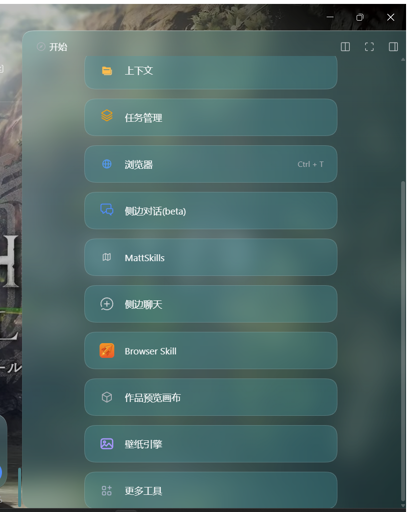

# dsh-panel-scroll

[](LICENSE)

给 **DeepSeek Harness**（DSH）Web / Desktop 界面打的一个小布局补丁：

1. **左侧面板列表不再吃掉整个侧栏** —— 默认只显示 4 行（学习 / 插件 / 插件市场 / 自动化任务…），剩下的用滚轮滑出来，「工作区」往上升、会话列表多露几条。
2. **右侧栏不再裁掉内容** —— 右栏里凡是"内容比盒子高、却被 `overflow: hidden/clip` 切掉"的容器，改成可以上下滚动。

变更记录见 [CHANGELOG.md](CHANGELOG.md)，最近一版的说明见 [v0.2.4 release notes](docs/release-notes/v0.2.4.md)。




---

## 为什么需要它

DSH 的 `sidebar.panellist` 有几个格子就长几行，条目一多，「工作区」就被挤出窗口；右栏有些 tab 的内容溢出却被 `overflow: hidden` 裁掉，既看不见也滚不到。这两处都不是配置项，插件注册接口也只接受 `id / order / label`，没有尺寸参数——所以只能由客户端插件在 DOM 层补。

## 安装

**方式一：本地目录（开发/自用）**

```bash
dsh plugin --profile <你的 profile> add /绝对路径/dsh-panel-scroll
```

或者在 DSH 里让 agent 用 `plugin_manager` 的 `install_bundle` 指向该目录。装完**重启一次 DSH**。

**方式二：npm（如果已发布）**

```bash
dsh plugin --profile <你的 profile> add dsh-panel-scroll
```

> 安装后重启 DSH 才生效；客户端插件代码是在启动时装载的。

## 配置

全部走 `localStorage`，改完刷新页面即可（不需要重启）：

| 键 | 默认 | 说明 |
|---|---|---|
| `dsh-panel-scroll:rows` | `4` | 面板列表显示几行，`1`–`20`。设成 `3` 时算上「学习」那一行正好 4 行 |
| `dsh-panel-scroll:unclog` | 开 | 设为 `"off"` 关闭右栏的滚动修复，只保留左侧 4 行封顶 |

```js
// DevTools Console
localStorage['dsh-panel-scroll:rows'] = 3
location.reload()
```

## 工作原理

- **左侧**：插件往 `sidebar.panellist` 注册一个**不可见的标记行**。它的 DOM 节点必然落在真正的面板列表里，插件从这个锚点往上走，找到"自己那一行"和"行列表"（判据是*有没有同 tag 同 class 的兄弟*，不是硬编码的类名），再给列表发布一条 `max-height: N × 行距` 的样式表规则。
- 用样式表 + `!important` 而不是内联样式：shell 重渲染会把内联值冲掉。
- **右侧**：不认类名，先按"贴着视口右边缘、高度 ≥ 70% 视口的最宽容器"定位右栏，再扫描其子树：
  - 内容比盒子高、且被 `hidden/clip` 裁掉的容器 → 改成 `overflow-y: auto`；
  - **起始侧溢出**：若是 `justify-content: flex-end` / `center` 这类末端或居中对齐，多出的内容会落在容器**上边界之外**——`scrollHeight` 不计入、任何 `scrollTop` 都够不到（表现为"滚到顶也看不到第一项"）。这类容器往往还是 `overflow: visible`（只是把内容漏到盒子外面），所以这条判据**先于** overflow 判断执行：检测到"有子元素跑到容器上边界之上"就把对齐改成 `flex-start`，让溢出变成正常的下方溢出、可滚动。

## 已知限制

- **依赖 shell 的 DOM 结构**。虽然刻意避开类名（DSH 用的是 CSS Module 哈希类名，如 `wtg9ga_`、`acoR2W_`），但 shell 若改了层级关系，插件可能失效——失效时表现为"没效果"，不会破坏界面。
- 在 **`dsh 0.2.1-rc.2`** 上验证过。`package.json` 里 `dsh.engines.dsh` 声明为 `>=0.2.1-rc.2 <0.3.0`。
- 右栏关闭时，"贴右边的那条"是主区，因此右栏规则也会作用到主区。不想要就把 `dsh-panel-scroll:unclog` 设成 `"off"`。
- 注册的标记项 `label` 为空，会出现在面板列表的"更多"菜单/无障碍树里（一个空项）。
- 面板少于 2 个时左侧封顶逻辑不生效（没有兄弟行可判定）。
- 高度 **小于 60px** 的被裁容器不处理（阈值内是滚动条比内容还高的区域，修了反而更糟）。
- 开发时改完 `client.js`，**刷新页面**即可生效，不需要重启 DSH（客户端模块在页面加载时重新装载）。

## 卸载

```bash
dsh plugin --profile <你的 profile> remove dsh-panel-scroll
```

或者在 Plugins 页面把 `dsh-panel-scroll` 关掉/卸载。插件**全部效果都走注入的样式表 + 类名**，卸载时样式表移除、加过的类在 `dispose()` 里清掉，不残留（0.2.2 及更早版本曾用内联样式，卸载后左栏会保持封顶直到刷新；0.2.3 起修正）。

## 开发

这个包是 `link:` 安装到 profile 的，改 `client.js` 后**刷新页面**即可（客户端模块在页面加载时重新装载）：

```
plugins/dsh-panel-scroll/
├── package.json
├── cordis.patch.yml   # 一条 insert 行
├── index.js           # 宿主半包（空实现）
├── client.js          # 全部逻辑
├── tests/smoke.mjs    # 无依赖冒烟测试：node tests/smoke.mjs
├── tests/harness.html # 复刻 shell 骨架的浏览器验收页
├── scripts/push-api.mjs
├── icon.svg
└── docs/*.png
```

`index.js` 只是为了让 bundle 有一个宿主行；所有逻辑都在 `client.js`，通过 `window.__ModuleLoader__.load({ id, factory })` 暴露 `apply/inject`。

两种验证方式（都不需要装进 DSH）：

```bash
node tests/smoke.mjs        # 无依赖：装载 client.js，跑 apply()/注册/销毁
# 浏览器打开 tests/harness.html（复刻 shell 骨架），底部打印 HARNESS PASS
```

```bash
# 无头 Edge 跑一遍并截图
msedge --headless=new --disable-gpu --window-size=1400,900 \
  --screenshot=harness.png tests/harness.html
```

### 推送到 GitHub（git 通道不通时）

某些网络下 `git push` 到 `github.com:443` 会被重置，而 `api.github.com` 正常。仓库里带了一个走 **Git Data API** 的推送脚本：

```bash
gh auth login                      # 一次性
node scripts/push-api.mjs --dry-run  # 先看会推什么（文件/mode/父提交）
node scripts/push-api.mjs            # 推 main
node scripts/push-api.mjs feat/x     # 推其他分支
```

它用相同的 blob / tree / **文件 mode** / 父提交 / 作者与提交时间重建提交，因此**产出的 SHA 与本地 HEAD 完全一致**（脚本会断言，不一致就退出，不会写坏远端）。

> 推送涉及 `.github/workflows/` 时需要额外的 `workflow` scope：`gh auth refresh -h github.com -s workflow`。没有这个 scope 时 GitHub 会返回 **404**（而不是 403），看起来像"文件不存在"。

## License

MIT —— 见 [LICENSE](LICENSE)。

---

### English

A small layout patch for the DeepSeek Harness web UI: the sidebar panel list is capped at N rows (default 4) and scrolls for the rest, and clipped (`overflow: hidden|clip`) containers inside the right column are made scrollable. Structural DOM anchoring — no hard-coded shell class names. Verified against `dsh 0.2.1-rc.2`. MIT.
